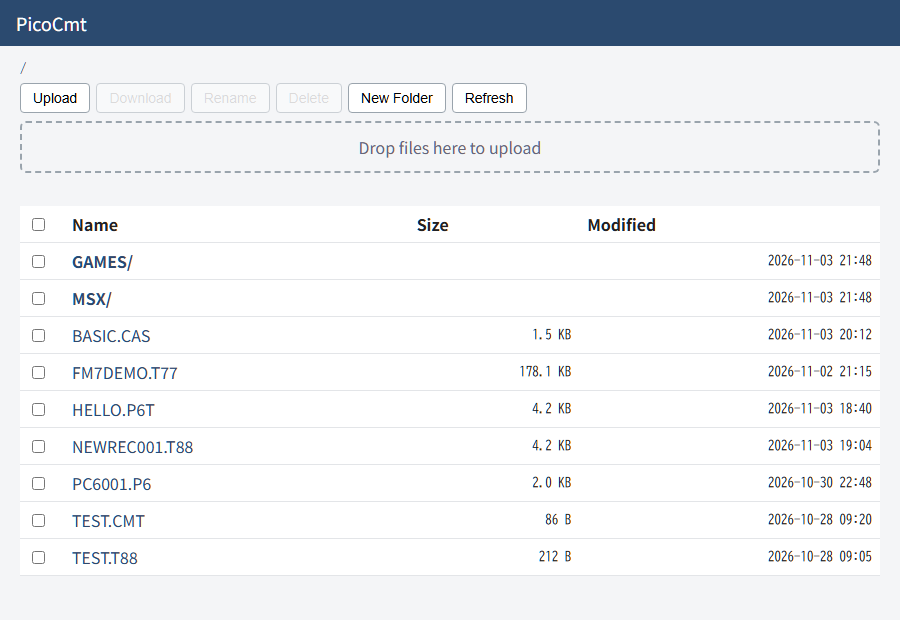

# PicoCmt User Manual

[日本語](MANUAL.md) | **English**

This device is a CMT (cassette tape) emulator for 8-bit retro PCs, built on the Raspberry Pi Pico W. It plays tape image files on the SD card as audio (LOAD), and records audio from the real machine (SAVE), converting it into a tape image and saving it to the SD card. You can also manage the files on the SD card over Wi-Fi from a browser on your PC or smartphone, or read and write the SD card as a USB drive from a PC connected by USB.

The supported file formats are as follows.

| Extension | Main machines | Playback | Recording | Append |
|---|---|---|---|---|
| `.T88` | PC-8801 / PC-8001 (tagged format) | Yes | Yes | Yes |
| `.CMT` | PC-8801 / PC-8001 (raw format) | Yes | Yes | - |
| `.P6` | PC-6001 (raw format) | Yes | Yes | - |
| `.P6T` | PC-6001 (format that stores the baud rate and the lengths of silence and leader tone for each block) | Yes | Yes | Yes |
| `.CAS` | MSX | Yes | Yes | Yes |
| `.T77` | FM-7 | Yes | Yes | Yes |
| `.RAW` | The recorded waveform as is (a PicoCmt-specific format; any machine) | Yes | Yes | - |
| `.WAV` | A WAV file recorded from a tape (linear PCM) | Yes | - | - |

`.RAW` and `.WAV` files can also be converted into the formats above on the device ([4-3](#4-3-the-recorded-waveform-raw-and-wav)). Compressed audio such as MP3 is not supported.

> **[Important] Power supply**
>
> **When using Wi-Fi, power the device from a source with enough current, such as an AC adapter (USB charger).**
> Wi-Fi traffic draws a large current, so the power supply can become unstable when the device is powered from a PC's USB port or a USB hub (including self-powered hubs with their own AC adapter).
> An unstable power supply causes LOAD / SAVE errors on the retro PC (confirmed on a PC-8801), so Wi-Fi is disconnected automatically during playback and recording.

## 1. Buttons and Basic Operation

The device has nine buttons.

*   **[UP] / [DOWN]**: Move the cursor up and down, change characters
*   **[LEFT] / [RIGHT]**: Move between folder levels, change the baud rate, cue (seek), change setting values, move the cursor left and right
*   **[OK]**: Confirm, open a folder, start playback or recording
*   **[CANCEL]**: Cancel, go back to the parent folder
*   **[PLAY]**: Start / pause playback
*   **[REC]**: Prepare for recording, save settings
*   **[STOP]**: Stop, return to the file browser, open the settings menu (long press in the file browser)

---

## 2. File Browser (Idle Screen)

This is the first screen shown when an SD card is inserted. It lists the folders and the files of supported formats on the SD card.

*   **Move**: Select a file with **[UP] / [DOWN]**.
*   **Open a folder**: Select a folder and press **[OK]** or **[RIGHT]**.
*   **Go back to the parent folder**: Press **[CANCEL]** or **[LEFT]**.
*   **Settings menu**: Long press **[STOP]** (about 1 second) to open it.
*   While connected to Wi-Fi, a Wi-Fi icon is shown in the top right corner of the screen.
*   Files added or deleted over Wi-Fi appear in the list within a few seconds.
*   With `Filter:` in the settings menu, you can limit the list to files with one extension ([5](#5-settings-menu-recording-format-wi-fi-and-usb-drive)). While a filter is on, it is shown to the right of the path at the top of the screen, as in `[T88]`. Folders are always shown.
*   Select a `.RAW` / `.WAV` file and hold **[OK]** for about 1 second to open the conversion menu ([4-3](#4-3-the-recorded-waveform-raw-and-wav)). If you release it right away, the playback standby screen appears, the same as for other files.

### Changing the baud rate
When you select a `.CMT` / `.P6` / `.CAS` file, a baud rate selector appears on the right side of the screen.
*   With the file selected, press **[LEFT] / [RIGHT]** to switch the baud rate.
    *   **CMT / P6 files**: `600` or `1200` (CMT and P6 share the same setting)
    *   **CAS files**: `1200` or `2400`
*   Because **[LEFT] / [RIGHT]** switch the baud rate for these files, start playback with **[OK]** or **[PLAY]**.
*   `.P6T` files contain the baud rate, so you do not need to select it.

---

## 3. Playing a Tape (Loading into the PC)

These are the steps to load a program into the PC.

1.  In the file browser, select the file to play and press **[OK]** or **[PLAY]**.
2.  The playback standby screen (`Status: STANDBY`) appears.
3.  Run the load command (such as `LOAD` or `CLOAD`) on the PC.
    *   If the REMOTE terminal is connected, playback starts automatically when the PC turns the cassette motor on.
    *   If the REMOTE terminal is not connected, press **[OK]** or **[PLAY]** on the device to start playback.
4.  During playback (`Status: PLAYING`), the progress through the file and the elapsed time are shown, and the tape animation moves.
5.  Press **[PLAY]** during playback to pause (`Status: PAUSED`). Press **[OK]** or **[PLAY]** again to resume.
    *   If the REMOTE terminal is connected, the device returns to playback standby when the PC turns the motor off.
6.  When playback reaches the end, `Status: COMPLETE` is shown. Press **[OK]** or **[STOP]** to return to the file browser.
7.  To stop partway, press **[STOP]**.

### Cueing (seek)
During playback standby or playback, press **[LEFT] / [RIGHT]** to cue.
*   **T88 files**: Detects the silent sections (blanks) of the tape and skips to the previous or next data block.
    *   **[RIGHT]**: Go to the next block.
    *   **[LEFT]**: Go back to the start of the current block. If pressed within 3 seconds of starting playback (or of the previous cue), go back to the previous block.
*   **Other formats**: **[LEFT]** returns to the start of the file. **[RIGHT]** ends playback.

---

## 4. Recording to Tape (Saving from the PC)

Records the tape signal output by the PC, and converts and saves it as a tape image.

### 4-1. New recording
1.  In the file browser, select a folder or a file that cannot be appended to, and press **[REC]**.
    *   The format of the recorded file is chosen with `Rec Fmt` in the settings menu ([5-1](#5-1-rec-fmt-changing-the-recording-format)).
2.  A temporary file name `NEWRECxxx.T88` (the extension depends on `Rec Fmt`) is assigned, and the recording standby screen (`REC STANDBY`) appears.
3.  Start recording.
    *   If the REMOTE terminal is connected, recording starts automatically when the PC turns the cassette motor on.
    *   If the REMOTE terminal is not connected, press **[OK]** on the device to start recording.
4.  Run the save command on the PC.
    *   `Wait...` is shown until a signal arrives. Once a signal is detected, the elapsed time is shown.
5.  Recording ends when one of the following happens:
    *   You press **[STOP]**
    *   The PC turns the motor off (if the REMOTE terminal is connected)
    *   The signal stops for about 8 seconds
6.  The "Converting..." screen appears automatically, and the recorded data is converted and saved to a file.
    *   The baud rate (600 / 1200 / 2400) is detected automatically from the recorded signal.
    *   If the data contains a program name, the file is renamed to that program name (for example, `GAME.T88`). If a file with the same name already exists, a number is added, as in `GAME(1).T88`.
    *   Tapes that switch between 600 and 1200 baud within a block, and data with parity (a byte format used by the loaders of some software), can be recorded and played back with `.T88`. `.CMT` has no place to store the baud rate and similar information, so record such tapes as `.T88`.
    *   When `Rec Fmt` is `RAW`, the recording is not converted; the recorded waveform is saved as is as `NEWRECxxx.RAW` (the file is not renamed).

Press **[STOP]** or **[CANCEL]** on the recording standby screen to return to the file browser without recording.

### 4-2. Appending a recording
1.  In the file browser, select an existing `.T88` / `.T77` / `.CAS` / `.P6T` file and press **[REC]**.
2.  The recording menu appears.
    *   `Create New File` (create a new file)
    *   `Append to File` (append to the selected file)
3.  Choose with **[UP] / [DOWN]** and press **[OK]** to go to the recording standby screen. The rest is the same as a new recording.
    *   The appended data is converted into the same format as the target file (`Rec Fmt` in the settings menu is not used).
    *   When appending, the program name of the appended data is added after the original file name (for example, `GAME_DATA.T88`).
    *   When reading a `.P6T` / `.P6` file containing several programs with the **built-in compatible ROM** of the PC6001VX emulator, specifying the second or a later program with `CLOAD "name"` makes it keep skipping forever (a bug in compatible ROM Ver.0.8.2; the file itself is fine). Either read the programs in order with `CLOAD` without a name, or use `CLOAD "name"` right after loading the previous program.

### 4-3. The recorded waveform (RAW) and WAV
A `.RAW` file holds the waveform recorded by the device as is, without conversion. Even a tape that does not convert well can be kept and played back as a waveform. A `.WAV` file is a WAV file of tape audio recorded on a PC or similar.
*   **Recording**: Set `Rec Fmt` in the settings menu to `RAW` and record. Appending to a `.RAW` file is not possible. See [RAW_FORMAT_en.md](RAW_FORMAT_en.md) for the file format.
*   **Playback**: Select the file and play it, the same as other formats. The waveform is output as is, so there is no baud rate to choose. For cueing, **[LEFT]** returns to the start of the file, and **[RIGHT]** ends playback.
    *   `.WAV` files in linear PCM (8 / 16 / 24 / 32 bits, any sampling rate) can be played. For stereo files, the left channel is used. Floating-point and compressed (MP3, etc.) WAV files cannot be played.
    *   WAV files recorded at too low or too high a level (with clipping) may not play back correctly.
*   **Conversion**: In the file browser, select a `.RAW` / `.WAV` file and hold **[OK]** for about 1 second to open the conversion menu (CONVERT).
    1.  Choose the target format (`T88` / `CMT` / `CAS` / `P6` / `P6T` / `T77`) with **[LEFT] / [RIGHT]**. The format of `Rec Fmt` in the settings menu is selected first.
    2.  Press **[OK]** to start converting. The progress is shown during conversion. A long WAV file can take a few minutes.
    3.  When it finishes, the name of the new file (`Done:`) or `Convert failed` is shown. Press **[OK]** to return to the file browser with the new file selected. Press **[STOP]** to go back without converting.
    *   The new file is saved in the same folder as the original, with the extension changed (for example, `NEWREC001.RAW` → `NEWREC001.T88`; if the name already exists, `_2` or similar is added). If the data contains a program name, the file is renamed to that program name, the same as when recording.
    *   The original `.RAW` / `.WAV` file is kept.

---

## 5. Settings Menu (Recording Format, Wi-Fi, and USB Drive)

Long press **[STOP]** on the file browser screen to open the settings menu (SETTINGS).
Choose an item with **[UP] / [DOWN]**, and press **[STOP]** or **[CANCEL]** to return to the file browser.

| Item | Operation | Description |
|---|---|---|
| `Rec Fmt:` | **[LEFT] / [RIGHT]** | File format for new recordings (saved immediately) |
| `Filter:` | **[LEFT] / [RIGHT]** | Extension of the files shown in the file browser (`ALL` / `T88` / `CMT` / `CAS` / `P6` / `P6T` / `T77` / `RAW` / `WAV`). Saved immediately. `ALL` shows all files |
| `WiFi:` | Choose with **[LEFT] / [RIGHT]**, then **[OK]** | Wi-Fi `ON` / `OFF`. Shows `DISABLED` until Wi-Fi settings are saved |
| `WiFi Config` | **[OK]** | Set the Wi-Fi network (SSID) and password, erase the saved settings |
| `Web Pass:` | **[LEFT] / [RIGHT]**, **[OK]** | Turn the Web file manager login `ON` / `OFF` (saved immediately). **[OK]** changes the password |
| `USB Drive` | **[OK]** | Use the SD card as a USB drive on the PC ([6](#6-usb-drive-reading-and-writing-the-sd-card-from-a-pc)). When the device is not connected to a PC, `USB Drive: no PC` is shown and it cannot be used |

The bottom line of the screen shows the Wi-Fi connection status.

### 5-1. Rec Fmt (changing the recording format)
Move the cursor to `Rec Fmt` in the menu and press **[LEFT] / [RIGHT]** to choose the format of files created by new recordings.
*   The choices cycle in this order: `T88` / `CMT` (PC-8801) → `CAS` (MSX) → `P6` / `P6T` (PC-6001) → `T77` (FM-7) → `RAW` (no conversion).
*   For the PC-6001, `P6T` is recommended. It records the baud rate (600 / 1200) of the recorded signal and the lengths of silence and leader tone for each block, and reproduces them during playback.

### 5-2. Wi-Fi and the Web file manager
Using the Wi-Fi of the Pico W, you can manage files from a browser on your PC or smartphone without removing the SD card.

> **[Important] When using Wi-Fi, power the device from a source with enough current, such as an AC adapter (USB charger)** (see "Power supply" at the beginning of this manual).

#### Initial Wi-Fi setup
1.  Select `WiFi Config` in the settings menu and press **[OK]**.
2.  The device scans for nearby access points. Choose the SSID to connect to with **[UP] / [DOWN]** and press **[OK]**.
3.  The password entry screen appears. Choose characters with **[UP] / [DOWN]**, move between positions with **[RIGHT] / [LEFT]**, and press **[OK]** or **[REC]** when finished to save.
    *   The available characters cycle in this order: space, uppercase letters, lowercase letters, digits, symbols (`` !"#$%&'()*+,-./:;<=>?@[\]^_`{|}~ ``). Hold **[UP] / [DOWN]** to cycle continuously.
    *   **[RIGHT]** can only move up to the position right after the last entered character.
    *   Pressing **[LEFT]** at the first position returns to the SSID selection. Press **[STOP]** to return to the settings menu without saving.

*   Wi-Fi settings saved with an older version (one that used a PIN code) cannot be used. After updating the firmware, please set them up again.

#### Connecting to Wi-Fi
1.  Set the `WiFi:` item in the settings menu to `ON` with **[LEFT] / [RIGHT]** and press **[OK]**.
    *   Until you press **[OK]**, the chosen value blinks and `OK?` is shown after it (the same applies to `OFF`).
2.  While connecting, `IP: Connecting..` is shown on the bottom line of the screen. Connecting takes from a few seconds to a little over ten seconds (if it cannot connect, it retries automatically several times).
3.  When the connection succeeds, the bottom line shows, in turn, the address to open in a browser (`http://picocmt.local/`), the `IP address`, and the login `ID` / `PW` (when login is `ON`).
4.  Open `http://picocmt.local/` in a browser on a PC or smartphone connected to the same Wi-Fi. When login is `ON`, enter the ID and password shown.
    *   If `picocmt.local` does not open (on some Android devices, for example), open `http://<IP address shown>/` instead.
*   If the connection fails, the `WIFI ERROR` screen shows the reason and what to check. Press **[OK]** to return to the settings menu.

    | Message | Meaning |
    |---|---|
    | `Wrong password` | The access point rejected the password. Enter the password again in `WiFi Config` |
    | `AP not found` | The access point was not found. Check the SSID and the distance (only the 2.4 GHz band is supported) |
    | `Could not join AP` | The device could not join. The signal may be weak; with some access points, a wrong password also shows this message |
    | `No IP address` | The device joined, but did not receive an IP address (check the router's DHCP) |
    | `Settings unreadable` | The saved Wi-Fi settings cannot be read. Set them up again in `WiFi Config` |

    The bottom of the screen shows the SSID and a number for the state of the Wi-Fi chip (useful when asking for help).
*   If Wi-Fi drops while connected, the device reconnects automatically.
*   If you turn the power off with `WiFi:` set to `ON`, the device connects automatically the next time it is powered on. If set to `OFF`, it does not connect automatically.
    *   If the automatic connection fails (for example, the router is not powered on), it returns to `OFF` without showing an error screen. It tries to connect again the next time it is powered on.
*   During playback and recording, Wi-Fi is disconnected automatically to keep the signal clean. The Web file manager cannot be used during that time.
    *   When playback or recording ends, the device reconnects automatically. For the few seconds to a little over ten seconds it takes to reconnect, the Wi-Fi icon in the top right corner of the file list blinks and the buttons do not respond. When the icon stops blinking and stays on, the device is connected.
    *   `WiFi:` in the settings menu stays `ON`. If reconnecting fails, it returns to `OFF` without showing an error screen.

#### Using the Web file manager

*   **Moving between folders:** Click a folder name to open it. Click `..` or the path at the top to go back.
*   **Upload:** Choose files with **[Upload]**, or drag and drop files onto the dashed box. When you choose several files, they are uploaded one at a time. If a file with the same name exists, you are asked whether to overwrite it.
*   **Download:** Click a file name, or check files and press **[Download]**. When you choose several files, they are downloaded one at a time.
*   **Delete:** Check items and press **[Delete]**. A folder can only be deleted when it is empty.
*   **Rename:** Check exactly one item and press **[Rename]**.
*   **Create a folder:** Press **[New Folder]** and enter a name.
*   **Modified date:** Shown in the `Modified` column of the list. Files without a timestamp are shown as `-`.
*   **Refresh the list:** Press **[Refresh]** to load the latest list. If an operation got no response during playback or recording, press **[Refresh]** after playback or recording ends.

#### Timestamps of recorded files
When connected to Wi-Fi, the device gets the time from an internet time server (NTP), and recorded files get a timestamp.
*   The Japanese version (`PicoCMT_JP.uf2`) records Japan time, and the worldwide version (`PicoCMT_WW.uf2`) records Coordinated Universal Time (UTC).
*   The device has no battery to keep the clock running, so it must connect to Wi-Fi every time it is powered on. Files recorded while not connected to Wi-Fi are dated `2000-01-01`.

#### Web file manager login (Web Pass)
With `Web Pass` in the settings menu, you can switch login (ID / password) `OFF` / `ON` with **[LEFT] / [RIGHT]** (the default is `ON`).
*   `ON`: The ID and password are required when opening the page in a browser. The `ID` / `PW` are also shown on the bottom line of the settings menu.
*   `OFF`: No login is required. Anyone connected to the same network can manage the files on the SD card, so use it only on a network that you alone use.

When using `ON`, it is recommended to change the password from the default (`pico`) so that others on the same network cannot access the SD card.
1.  Select `Web Pass` in the settings menu and press **[OK]**.
2.  Choose characters with **[UP] / [DOWN]**, move between positions with **[RIGHT] / [LEFT]**, and press **[OK]** or **[REC]** to save. Press **[STOP]** to go back without saving.
3.  To delete a character, set that position to a space (trailing spaces are removed when saving). If you save with all positions blank, the password returns to the default (`pico`).
*   The login ID is fixed to `pico`. The password can be up to 32 characters.
*   The Web file manager uses unencrypted communication (HTTP). Use it on your home network.

#### Resetting the Wi-Fi settings
Open `WiFi Config` in the settings menu and press **[LEFT]** on the access point selection screen. The confirmation `Clear saved WiFi settings (SSID/PASS)?` appears. Press **[OK]** to erase the saved SSID and password; Wi-Fi is turned `OFF`. Press **[STOP]** to go back without erasing.
*   While Wi-Fi settings are saved, `LEFT:Clear saved` is shown on the screen.

*   The Wi-Fi password is stored encrypted with an ID unique to the board, but someone who obtains the device may be able to extract it from the flash memory. Before giving away or disposing of the device, erase the settings first.

---

## 6. USB Drive (Reading and Writing the SD Card from a PC)

When the device is connected to a PC with a USB cable, you can use the SD card as a USB drive (removable disk) on the PC. You can copy and delete files with File Explorer or similar without removing the SD card.

### Starting the USB drive
Start it in one of the following ways.
*   **At power-on:** If the device is connected to a PC by USB, `PC connected. Use the SD card as a USB drive?` is shown within a few seconds after startup. **[OK]** starts the USB drive, and **[STOP]** goes to the usual file browser.
    *   This is not shown when the device is connected to a USB charger or an AC adapter.
    *   Wi-Fi does not connect automatically until you answer.
*   **From the settings menu:** Select `USB Drive` and press **[OK]**.

While the USB drive is on, the screen shows `--- USB DRIVE ---` and the amount the PC has read and written (`R:` read, `W:` write, in KB). A drive named `SD Card` appears on the PC and shows the contents of the SD card.
*   Right after the USB drive starts, the PC reads information from the SD card, so it may take a little while before the drive can be used.
*   Reading and writing are slower than with a card reader on the PC. When copying many large files, it may be more convenient to put the SD card in the PC's card reader or to use the Web file manager.

### Functions that stop while the USB drive is on
If the device and the PC change the SD card at the same time, files can be corrupted, so the other functions of the device stop while the USB drive is on.
*   Playback, recording, and the file browser cannot be used.
*   Wi-Fi is disconnected (the Web file manager cannot be used either). When the USB drive ends, Wi-Fi reconnects automatically according to the settings.

### Ending the USB drive
*   **Eject on the PC:** Right-click the drive in File Explorer and choose "Eject". The device returns to the file browser automatically.
*   **[STOP] on the device:** `Exit USB drive?` is shown. **[OK]** ends the USB drive, and **[STOP]** goes back. **If you have written files from the PC, eject the drive on the PC first, then press [OK]** (ending in the middle of a write can corrupt files).
*   **Unplug the USB cable:** The device returns to the file browser automatically. Do not unplug it in the middle of a write.

When the USB drive ends, the device reads the SD card again and returns to the top folder in the file browser. Files added or deleted on the PC are reflected in the list.

### Notes
*   Files written from the PC get the PC's date and time.
*   While the device is connected to a PC, an `SD Card` drive (like a card reader with no card inserted) may be visible on the PC even when the USB drive is not on. It is normal that it shows nothing when opened.
*   Do not remove the SD card while the USB drive is on.
