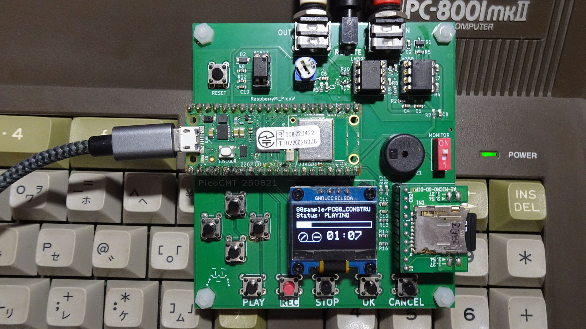

**日本語** | [English](README_en.md)

# PicoCmt - 8bit PC用 CMT(カセット磁気テープ) エミュレータ

Raspberry Pi Pico W を使用した、8bitレトロPC向けのカセット磁気テープ（CMT）エミュレータです。
SDカードに保存されたテープイメージファイルを実機へ音声信号としてロードしたり、実機からのセーブ音声を録音してテープイメージに変換・保存することができます。
Wi-Fi経由で、PCやスマホのブラウザからSDカードのファイルを操作することもできます。

## 主な機能
* **ファイルからの再生 (LOAD)**
  * 対応フォーマット:

    | 拡張子 | 主な機種 |
    |---|---|
    | `.T88` | PC-8801 / PC-8001 (タグ形式) |
    | `.CMT` | PC-8801 / PC-8001 (ベタ形式) |
    | `.P6` / `.P6T` | PC-6001 |
    | `.CAS` | MSX |
    | `.T77` | FM-7 |
  * ファイル内のデータをFSK音声信号に変換し、PCへ出力します。
  * PCのREMOTE端子 (カセットのモーター制御) に連動して、再生の開始・一時停止を自動で行います。
  * T88 は無音区間 (ブランク) の前後へ頭出しできます。
* **実機からの録音・変換 (SAVE)**
  * PCからの出力音声を録音し、自動的に上記のいずれかの形式に変換してSDカードに保存します。
  * ボーレート (600 / 1200 / 2400) は録音した信号から自動で判別します。
  * 録音したデータに含まれるプログラム名を読み取り、ファイル名を自動で付けます。
  * 既存ファイルへの追記録音 (アペンド) にも対応しています (`.T88` / `.T77` / `.CAS` / `.P6T`)。
* **Wi-Fi / Webファイルマネージャ機能**
  * Pico W のWi-Fi機能を利用し、内蔵のWebサーバーを起動できます。
  * SDカードを抜き差しすることなく、PCやスマホのブラウザから `http://picocmt.local/` を開いて、ファイルのアップロード・ダウンロード・削除・名前の変更・フォルダの作成ができます。
  * 複数のファイルをまとめて選ぶと、1つずつ順番にアップロード・ダウンロードします。
  * ログイン (ID/パスワード) の ON/OFF とパスワードは本体の設定メニューで変更できます。
  * Wi-Fi接続中はNTPで時刻を合わせ、録音したファイルに日時を付けます (日本版は日本時間、全世界共通版はUTC)。
  * 再生・録音中は、Wi-Fiの通信で電源が揺れて信号が乱れないよう、Wi-Fiを自動で切断し、終わったらつなぎ直します。
  * **Wi-Fiを使うときは、ACアダプタ (USB充電器) など、電流に余裕のある電源から給電してください。** Wi-Fiの通信には大きな電流が流れるため、PCのUSB端子やUSBハブからの給電では動作が不安定になることがあります。
  * 設定したWi-Fiパスワード等は、本体固有のIDで暗号化してEEPROMに保存します。
    ただし、本体を入手した人はフラッシュメモリから取り出せる可能性があります。気になる場合は、ゲスト用やIoT機器用のWi-Fiを使ってください。

---

## 必要なハードウェア

基板のガーバーデータは`hardware/JLCPCB`を参照してください。JLCPCB等に発注することでプリント基板の生産が可能です。
主要な部品構成は以下の通りです。詳細な部品リストや定数は `hardware/parts.md` を参照してください。

* **マイコンボード:** Raspberry Pi Pico W
  * **電源:** PCのUSB端子やUSBハブ (セルフパワーのものも含む) から給電していると、Wi-Fiの通信で電源が不安定になり、ロード・セーブがエラーになることがあるため (PC-8801 で確認)、ロード・セーブ中はWi-Fiを自動で切断します。**Wi-Fiを使うときは、ACアダプタ (USB充電器) など、電流に余裕のある電源から給電してください。**
* **ディスプレイ:** 0.96インチ OLEDディスプレイ (SSD1306 / I2C接続)
* **ストレージ:** MicroSDカードモジュール (SPI接続)
* **アナログ回路:** 
  * オペアンプ `MCP6022` (信号増幅・波形整形用)
  * コンパレータ `LM393` (録音パルス検出用)
  * フォトカプラ `PC817` (REMOTE端子制御用)
* **インターフェース:**
  * タクトスイッチ ×10 (操作用)
  * 3.5mm モノラルジャック ×2 (LOAD用, SAVE用)
  * 2.5mm モノラルジャック ×1 (REMOTE制御用)
  * 圧電ブザー (モニタースピーカー用)

---

## 開発環境とビルド手順

本プロジェクトは **PlatformIO** を使用して開発されています。Arduinoコアには `earlephilhower` 版の Raspberry Pi PicoW/RP2040 コアを使用します。

### 1. インストール
1. リリースに配置されているファームウェアファイル`PicoCMT*.uf2`をダウンロードします。
   ファイル名の末尾は地域の設定です。使う国に合わせて選んでください。

   | ファイル | 使う国 | Wi-Fiの地域設定 | 時刻 |
   |---|---|---|---|
   | `PicoCMT_JP.uf2` | 日本 | 日本 (チャンネル1〜13) | 日本時間 (NTP: `ntp.nict.jp`) |
   | `PicoCMT_WW.uf2` | 日本以外の国 | 全世界共通 | UTC (NTP: `pool.ntp.org`) |
2. PCとRaspberryPi PicoWをUSB接続します。
3. RaspberryPi PicoWの`BOOTSEL`ボタンを押しながら、PicoCMT基板上のRESETボタンを押下します。
4. PC上でRaspberryPi PicoWのフォルダが開かれますので、そこに`PicoCMT*.uf2`をコピーします。
5. RaspberryPi PicoWが自動で再起動され、PicoCMTが起動します。

以前のバージョン (Wi-Fi設定にPINコードを使っていたもの) から更新した場合、保存していたWi-Fi設定は使えなくなります。もう一度設定してください。

### 2. 開発環境の準備
以下はソースコードからビルドする際の手順です。通常は不要です。
1. [Visual Studio Code (VSCode)](https://code.visualstudio.com/) をインストールします。
2. VSCodeの拡張機能から **PlatformIO IDE** をインストールします。
3. リポジトリをクローンしてください。

### 3. PIOファイルのコンパイルについて
PicoのPIO（アセンブリ）コードは、ビルド前に自動的にC/C++のヘッダファイルに変換される仕組みになっています。
`platformio.ini` 内の `extra_scripts = pre:scripts/generate_pio_headers.py` により、ビルド時に自動で `pio/` フォルダ内のファイルが処理され、`include/generated/` ディレクトリにヘッダファイルが出力されます。手動で実行する必要はありません。

### 4. ビルド
1. VSCodeで `PicoCmt` フォルダを開きます。
2. 初回起動時、PlatformIOが自動的に必要なツールチェーンとライブラリ（Adafruit GFX, SSD1306等）をダウンロードします。
3. 画面下のPlatformIOツールバーから **[✓] Build** をクリックしてビルドを実行します。
   地域ごとの2つのファームウェアがまとめてビルドされ、`.pio/build/<環境名>/PicoCMT_<地域>.uf2` に出力されます。

| 環境名 | 出力ファイル | Wi-Fiの地域設定 | 時刻 |
|---|---|---|---|
| `rpipico_ww` | `PicoCMT_WW.uf2` | 全世界共通 (`CYW43_COUNTRY_WORLDWIDE`) | UTC |
| `rpipico_jp` | `PicoCMT_JP.uf2` | 日本 (`CYW43_COUNTRY_JAPAN`) | 日本時間 (`FW_REGION_JP`) |

書き込み (Upload) は環境を1つ指定して行ってください。例: `pio run -e rpipico_jp -t upload`

---

## 使い方・操作方法

操作方法については、付属の **[操作マニュアル](MANUAL.md)** を参照してください。
基本的なUI操作、再生（LOAD）・録音（SAVE）の手順、ボーレートの変更方法、Wi-Fi/Webファイルマネージャの設定方法について記載されています。

---

## 注意事項・免責事項

* 本デバイスの接続や使用により発生したいかなる損害（レトロPC本体の故障、データの消失など）についても、開発者は責任を負いません。自己責任でご使用ください。
* **Wi-Fiを使うときは、ACアダプタ (USB充電器) など、電流に余裕のある電源から給電してください。** PCのUSB端子やUSBハブからの給電では、Wi-Fiの通信で電源が不安定になることがあります。
* ロード・セーブ中はWi-Fiを自動で切断します (Wi-Fiの通信で電源が不安定になり、レトロPCへのロード・セーブがエラーになることがあるため。PC-8801 で確認)。
* Webファイルマネージャは暗号化されていない通信 (HTTP) を使います。家庭内のネットワークでお使いください。
* 本体を人に譲る・手放すときは、設定メニューの `WiFi: CLEAR` で、保存されているWi-Fi設定を消去してください。
