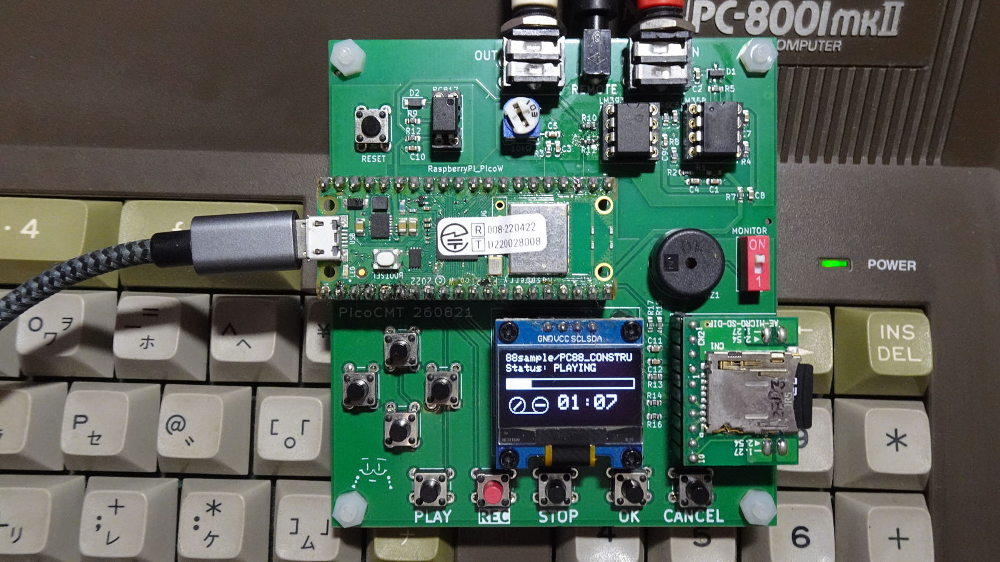

[日本語](README.md) | **English**

# PicoCmt - CMT (Cassette Tape) Emulator for 8-bit PCs

PicoCmt is a cassette tape (CMT) emulator for 8-bit retro PCs, built on the Raspberry Pi Pico W.
It plays tape image files stored on an SD card to the computer as audio signals (LOAD), and records the audio that the computer outputs when saving, converting it into a tape image file (SAVE).
You can also manage the files on the SD card over Wi-Fi from a browser on your PC or smartphone.

## Features
* **Playback from files (LOAD)**
  * Supported formats:

    | Extension | Main machines |
    |---|---|
    | `.T88` | PC-8801 / PC-8001 (tagged format) |
    | `.CMT` | PC-8801 / PC-8001 (raw format) |
    | `.P6` / `.P6T` | PC-6001 |
    | `.CAS` | MSX |
    | `.T77` | FM-7 |
  * Converts the data in the file into an FSK audio signal and outputs it to the PC.
  * Starts and pauses playback automatically, following the PC's REMOTE terminal (cassette motor control).
  * T88 files can be cued to the blocks before and after silent sections (blanks).
* **Recording and conversion from the real machine (SAVE)**
  * Records the audio output by the PC and automatically converts it into one of the formats above, saving it to the SD card.
  * The baud rate (600 / 1200 / 2400) is detected automatically from the recorded signal.
  * Reads the program name contained in the recorded data and uses it as the file name.
  * Supports appending a recording to an existing file (`.T88` / `.T77` / `.CAS` / `.P6T`).
* **Wi-Fi / Web file manager**
  * Uses the Wi-Fi of the Pico W to run a built-in web server.
  * Without removing the SD card, open `http://picocmt.local/` in a browser on your PC or smartphone to upload, download, delete and rename files, and create folders.
  * When you select several files at once, they are uploaded or downloaded one at a time.
  * Login (ID / password) can be turned on or off, and the password can be changed, from the settings menu on the device.
  * While connected to Wi-Fi, the clock is set via NTP and recorded files get a timestamp (Japan time in the Japanese version, UTC in the worldwide version).
  * During playback and recording, Wi-Fi is disconnected automatically so that power fluctuations caused by Wi-Fi traffic do not disturb the signal, and reconnected when finished.
  * **When using Wi-Fi, power the device from a source with enough current, such as an AC adapter (USB charger).** Wi-Fi traffic draws a large current, so operation can become unstable when powered from a PC's USB port or a USB hub.
  * The Wi-Fi password and other settings are encrypted with an ID unique to the board and stored in EEPROM.
    However, someone who obtains the device may be able to extract them from the flash memory. If this concerns you, use a guest or IoT Wi-Fi network.

---

## Hardware

See `hardware/JLCPCB` for the Gerber data of the board. You can have the PCB manufactured by ordering from JLCPCB or similar services.
The main components are listed below. See `hardware/parts.md` for the detailed parts list and values.

* **Microcontroller board:** Raspberry Pi Pico W
  * **Power:** When powered from a PC's USB port or a USB hub (including self-powered hubs), Wi-Fi traffic can make the power supply unstable and cause LOAD / SAVE errors (confirmed on a PC-8801), so Wi-Fi is disconnected automatically during LOAD / SAVE. **When using Wi-Fi, power the device from a source with enough current, such as an AC adapter (USB charger).**
* **Display:** 0.96-inch OLED display (SSD1306 / I2C)
* **Storage:** MicroSD card module (SPI)
* **Analog circuit:**
  * Op-amp `MCP6022` (signal amplification and wave shaping)
  * Comparator `LM393` (pulse detection for recording)
  * Photocoupler `PC817` (REMOTE terminal control)
* **Interface:**
  * Tactile switches ×10 (for operation)
  * 3.5 mm mono jacks ×2 (LOAD, SAVE)
  * 2.5 mm mono jack ×1 (REMOTE control)
  * Piezo buzzer (monitor speaker)

---

## Development Environment and Build

This project is developed with **PlatformIO**. It uses the `earlephilhower` Raspberry Pi Pico W / RP2040 Arduino core.

### 1. Installation
1. Download the firmware file `PicoCMT*.uf2` from the releases.
   The end of the file name is the region setting. Choose the one for the country where you use the device.

   | File | Country | Wi-Fi region | Time |
   |---|---|---|---|
   | `PicoCMT_JP.uf2` | Japan | Japan (channels 1-13) | Japan time (NTP: `ntp.nict.jp`) |
   | `PicoCMT_WW.uf2` | Outside Japan | Worldwide | UTC (NTP: `pool.ntp.org`) |
2. Connect the Raspberry Pi Pico W to your PC via USB.
3. While holding the `BOOTSEL` button on the Raspberry Pi Pico W, press the RESET button on the PicoCMT board.
4. A Raspberry Pi Pico W drive opens on the PC. Copy `PicoCMT*.uf2` to it.
5. The Raspberry Pi Pico W restarts automatically and PicoCMT starts up.

If you update from an older version (one that used a PIN code for the Wi-Fi settings), the saved Wi-Fi settings can no longer be used. Please set them up again.

### 2. Preparing the development environment
The following steps are for building from source. They are not needed for normal use.
1. Install [Visual Studio Code (VSCode)](https://code.visualstudio.com/).
2. Install the **PlatformIO IDE** extension in VSCode.
3. Clone the repository.

### 3. Compiling the PIO files
The Pico's PIO (assembly) code is automatically converted into C/C++ header files before the build.
`extra_scripts = pre:scripts/generate_pio_headers.py` in `platformio.ini` processes the files in the `pio/` folder at build time and writes the header files to `include/generated/`. You do not need to run it manually.

### 4. Build
1. Open the `PicoCmt` folder in VSCode.
2. On the first start, PlatformIO automatically downloads the required toolchain and libraries (Adafruit GFX, SSD1306, etc.).
3. Click **[✓] Build** on the PlatformIO toolbar at the bottom of the window.
   The two firmware files, one per region, are built together and written to `.pio/build/<environment>/PicoCMT_<region>.uf2`.

| Environment | Output file | Wi-Fi region | Time |
|---|---|---|---|
| `rpipico_ww` | `PicoCMT_WW.uf2` | Worldwide (`CYW43_COUNTRY_WORLDWIDE`) | UTC |
| `rpipico_jp` | `PicoCMT_JP.uf2` | Japan (`CYW43_COUNTRY_JAPAN`) | Japan time (`FW_REGION_JP`) |

When uploading, specify a single environment. Example: `pio run -e rpipico_jp -t upload`

---

## Usage

For operating instructions, see the **[User Manual](MANUAL_en.md)**.
It covers the basic UI, the LOAD and SAVE procedures, changing the baud rate, and setting up Wi-Fi and the Web file manager.

---

## Notes and Disclaimer

* The developer accepts no responsibility for any damage caused by connecting or using this device (such as failure of the retro PC or loss of data). Use it at your own risk.
* **When using Wi-Fi, power the device from a source with enough current, such as an AC adapter (USB charger).** When powered from a PC's USB port or a USB hub, Wi-Fi traffic can make the power supply unstable.
* Wi-Fi is disconnected automatically during LOAD / SAVE (because Wi-Fi traffic can make the power supply unstable and cause LOAD / SAVE errors on the retro PC; confirmed on a PC-8801).
* The Web file manager uses unencrypted communication (HTTP). Use it on your home network.
* When you give away or dispose of the device, erase the saved Wi-Fi settings with `WiFi: CLEAR` in the settings menu.
